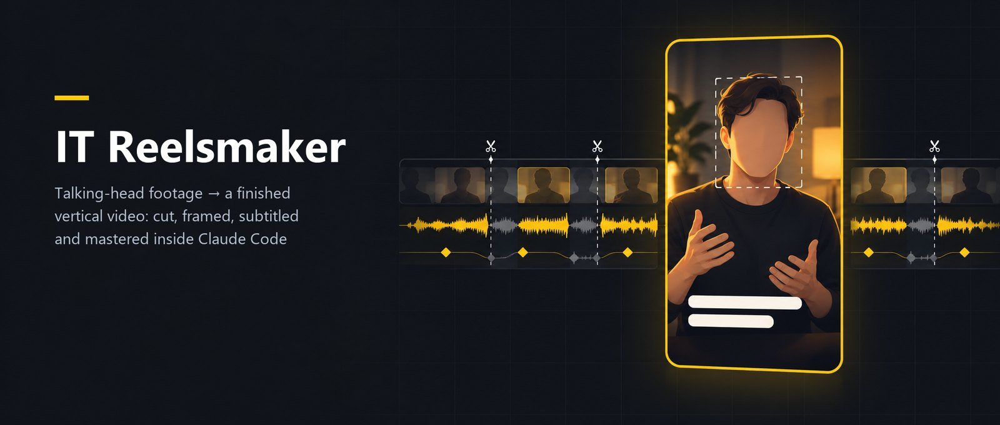
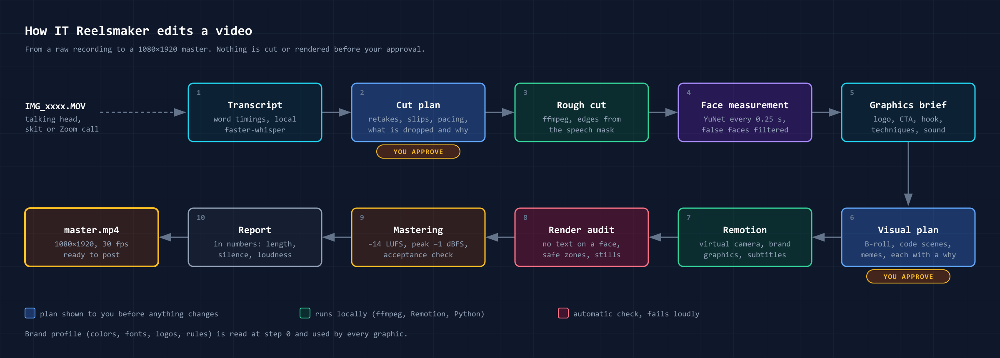
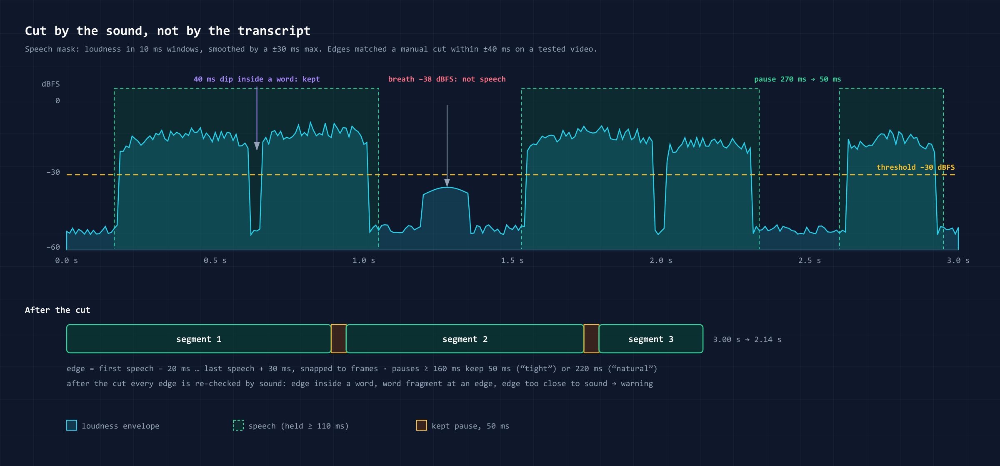
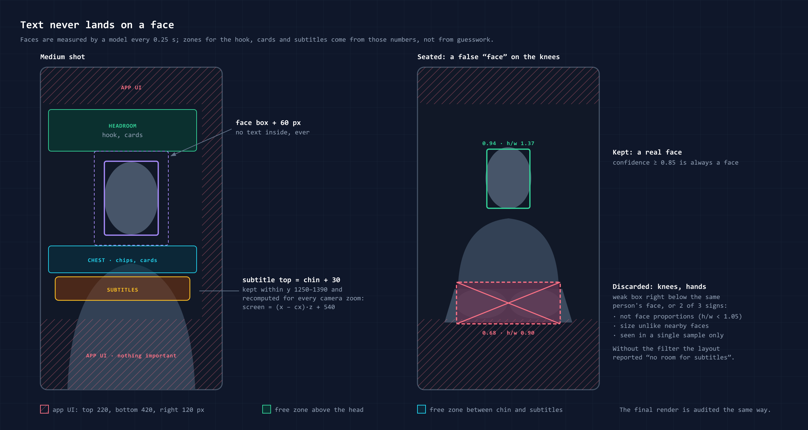

# IT Reelsmaker — Claude Code plugins for vertical video

English · [中文](README.zh-CN.md) · [Русский](plugins/it-reelsmaker/README.ru.md)

**Give Claude Code a raw talking-head take and get back a finished 1080×1920 Reel, Short or TikTok.** Pauses and retakes are cut by the audio, a virtual camera reframes the shot, subtitles are timed word by word, on-brand graphics are drawn in code, no text lands on a face, and the sound is mastered to −14 LUFS. The editing runs on your computer, and nothing is cut before you approve the plan.

> **Listed in Anthropic's official Claude plugin directory: 16,000+ installs and 5,000+ accounts active in the last 28 days** (directory statistics, November 2026).

## What you get

From one raw recording, for example a 1–2 minute phone take:

- **the master video**: 1080×1920, cut, reframed, with subtitles and your brand's graphics, loudness −14 LUFS with an acceptance check;
- **the cover**: picked from the video's frames, embedded in the master and saved next to it as a picture;
- **subtitles as `.srt`**, also translated into another language if you ask;
- **a report in numbers**: duration, silence left, loudness and peak, how many cuts and retakes were removed.

A podcast, webinar or interview of 10–90 minutes becomes **a series of clips** the same way: you approve a list of clip cards once, then each clip is finished like a single video. With no footage at all, the same designed scenes make **a 15–25 s promo**.

## Quick start

```bash
claude plugin marketplace add https://github.com/itpartypattaya/reels-montage.git
```

```bash
claude plugin install it-reelsmaker@itparty
```

Then, in Claude Code, in your editing folder:

> Edit a reel from IMG_4821.MOV for Acme: tight pacing, Marker style, subtitles on.

You need `ffmpeg`, Node.js 18+ and Python 3.9+. The plugin creates the Remotion project for you (`python scripts/kit.py new reels`) and asks for its settings on the first run. Full requirements and settings: [plugin README](plugins/it-reelsmaker/README.md).

## How it works



1. **Brand and style.** A saved brand profile (colors, fonts, logos, tone) or a new one from a name and 1–3 colors.
2. **Word-level transcript** on your computer, then a search for retakes and slips.
3. **Cut plan → your “yes”.** What stays, what goes and why, with 2–3 ways to open and close the video.
4. **Rough cut by the sound**: edges found by a speech mask (within ±40 ms of a manual cut on a tested video), one speech level across all pieces, color balanced by measurement.
5. **Visual plan → your “yes”.** Designed scenes and B-roll from your own library, each placed on its spoken word.
6. **Render in Remotion** with a virtual camera, then a check that no text covers a face and a self-review of the render before you see it.
7. **Mastering and the report.**





## The plugins

This repository is a Claude Code plugin marketplace, `itparty`, with two plugins:

| Plugin | What it does |
|---|---|
| [`it-reelsmaker`](plugins/it-reelsmaker/README.md) | The core: edits vertical short videos from talking-head footage, turns long recordings into series of clips, makes promos from designed scenes. Runs locally, no AI generation, no stock services. |
| [`it-reelsmaker-online`](plugins/it-reelsmaker-online/README.md) | Optional add-on: online stock footage, CC-licensed memes and paid AI video generation for B-roll, each only after you approve the plan. |

```bash
claude plugin install it-reelsmaker-online@itparty
```

The directory build can lag behind this repository; the marketplace install above always gets the latest version. What changed in each version: [CHANGELOG](plugins/it-reelsmaker/CHANGELOG.md). What data leaves your computer: [PRIVACY](plugins/it-reelsmaker/PRIVACY.md).

## Upgrading from `reels-montage`

Before version 1.0 this repository was a single skill installed by cloning it into `~/.claude/skills/reels-montage`. To upgrade:

1. Install the plugin as above.
2. Move your brand profiles from `~/.claude/skills/reels-montage/brands/<slug>/` to `<your editing project>/brands/<slug>/`. The skill offers to do this the first time it runs.
3. Delete the old clone.

## License

[MIT](LICENSE).

The plugins render with [Remotion](https://www.remotion.dev/), which has its own license: free for individuals, non-profits and companies of up to 3 employees; a larger company (an agency, for example) needs a Remotion company license ([license terms](https://github.com/remotion-dev/remotion/blob/main/LICENSE.md)).
