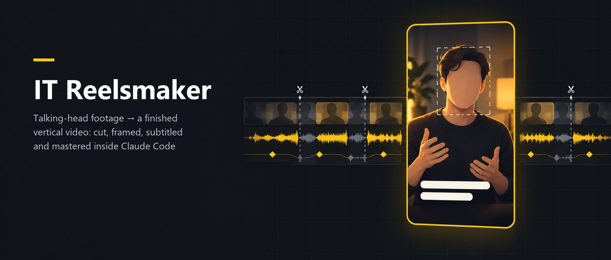
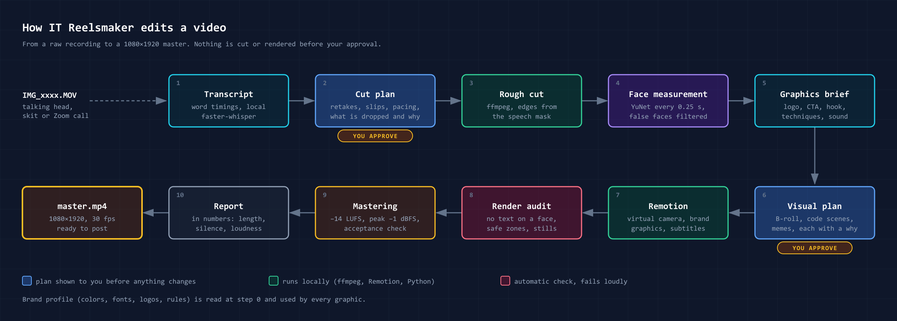
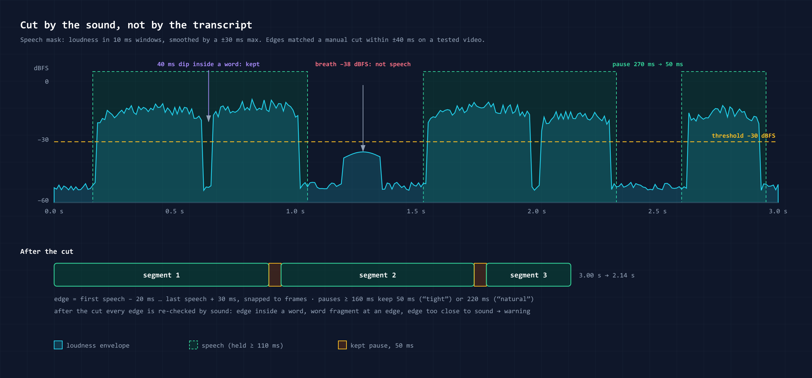
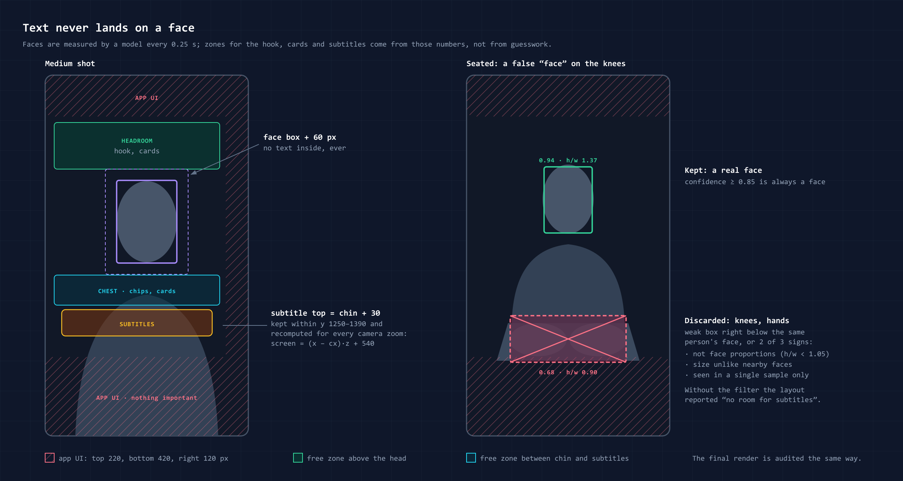

# IT Reelsmaker — 竖屏短视频的 Claude Code 插件

[English](README.md) · 中文 · [Русский](plugins/it-reelsmaker/README.ru.md)

**把一段口播原始素材交给 Claude Code，拿回一条剪好的 1080×1920 竖屏视频（Reels、Shorts、TikTok）。** 根据音频剪除停顿和重录片段，通过虚拟摄像机调整构图，字幕逐词对齐，品牌图形用代码绘制，文字不会压在人脸上，并对音频进行母带处理，将响度统一至 −14 LUFS。剪辑在你自己的电脑上进行，在你确认方案之前，什么都不会剪。

> **已收录于 Anthropic 官方 Claude 插件目录：累计安装 16,000+ 次，近 28 天活跃账户 5,000+ 个**（目录统计，2026 年 11 月）。

## 你会得到什么

以一段原始录像为例，比如手机拍的 1–2 分钟口播：

- **成片**：1080×1920，已剪辑、已重新构图，带字幕和品牌图形，响度 −14 LUFS，并附验收检查；
- **封面**：从视频画面中挑选，嵌入成片，同时另存一张图片；
- **`.srt` 字幕文件**，需要时也可以翻译成其他语言；
- **一份量化报告**：时长、剩余静音时长、响度和峰值、剪辑次数和移除的重录片段数。

10–90 分钟的播客、网络研讨会或访谈，用同样的方式变成**一组短视频**：你只需一次性确认短片方案卡片列表，之后每个片段都按单条视频的流程完成。完全没有素材时，同一套视觉场景可以做出 **15–25 秒的宣传片**。

**不想出镜？只要你的声音就够了。** 用手机录一段语音，就能得到一条**由代码绘制的场景配上你本人声音的讲解视频**，并带字幕。还可以让**品牌吉祥物**来主持：一个使用品牌配色的角色，会眨眼，会在你选定的词上做手势，嘴巴随你的录音开合。吉祥物可以用代码绘制，也可以用你自己的角色图片，插件会切出各个姿势并让它动起来。

## 快速开始

```bash
claude plugin marketplace add https://github.com/itpartypattaya/reels-montage.git
```

```bash
claude plugin install it-reelsmaker@itparty
```

然后在剪辑项目目录下，向 Claude Code 输入：

> Edit a reel from IMG_4821.MOV for Acme: tight pacing, Marker style, subtitles on.

（用中文说也可以，例如：“用 IMG_4821.MOV 给 Acme 剪一条 Reels，节奏紧凑，Marker 风格，打开字幕。”）

需要 `ffmpeg`、Node.js 18+ 和 Python 3.9+。插件会帮你创建 Remotion 项目（`python scripts/kit.py new reels`），首次运行时会提示你填写项目设置。完整的依赖和设置说明见[插件 README](plugins/it-reelsmaker/README.md)（英文）。

## 工作流程



1. **品牌与风格。** 选择已保存的品牌档案（颜色、字体、标志、调性），或者用名称和 1–3 种颜色新建一个。
2. **逐词转写**在你的电脑上完成，随后识别重录片段和口误。
3. **剪辑方案 → 你说“可以”。** 保留什么、剪掉什么、为什么，并给出 2–3 种开头和结尾的方式。
4. **基于音频粗剪**：用语音掩码（speech mask）找到每段的边界（在一条测试视频上，剪辑点相对人工剪辑的偏差在 ±40 毫秒以内），所有片段统一语音电平，按测量结果校正颜色。
5. **画面方案 → 你说“可以”。** 视觉场景和你自己素材库里的辅助画面（B-roll），每个画面都与对应词语说出的时间点对齐。
6. **在 Remotion 中渲染**，带虚拟摄像机；随后检查没有文字压住人脸，并在你看到之前先对渲染结果做一次自查。
7. **母带处理和报告。**





## 插件

本仓库是一个 Claude Code 插件市场 `itparty`，包含两个插件：

| 插件 | 作用 |
|---|---|
| [`it-reelsmaker`](plugins/it-reelsmaker/README.md) | 核心插件：把口播素材剪成竖屏短视频，把长录像变成一组短视频，用视觉场景做宣传片和以你的声音为主线的讲解视频，可选品牌吉祥物。在本地运行，不使用 AI 生成，不接入素材库服务。 |
| [`it-reelsmaker-online`](plugins/it-reelsmaker-online/README.md) | 可选扩展：在线视频素材、采用知识共享（CC）许可的梗图或梗视频，以及付费的 AI 视频生成（用作 B-roll），每一项都要在你确认方案之后才会执行。 |

```bash
claude plugin install it-reelsmaker-online@itparty
```

官方插件目录中的版本可能落后于本仓库；用上面的插件市场方式安装，可获取最新版本。各版本更新内容见 [CHANGELOG](plugins/it-reelsmaker/CHANGELOG.md)（英文），哪些数据会离开你的电脑见 [PRIVACY](plugins/it-reelsmaker/PRIVACY.md)（英文）。

## 从 `reels-montage` 升级

1.0 版本之前，本仓库是一个独立的 Skill（技能），通过克隆到 `~/.claude/skills/reels-montage` 来安装。升级方法：

1. 按上面的方式安装插件。
2. 把品牌档案从 `~/.claude/skills/reels-montage/brands/<slug>/` 移到 `<你的剪辑项目>/brands/<slug>/`。该 Skill 首次运行时会主动提出帮你移动。
3. 删除旧的克隆目录。

## 许可证

[MIT](LICENSE)。

插件使用 [Remotion](https://www.remotion.dev/) 渲染，Remotion 有自己的许可证：个人、非营利组织和不超过 3 名员工的公司可免费使用；规模更大的公司（例如代理机构）需要购买 Remotion 公司许可证（[许可条款](https://github.com/remotion-dev/remotion/blob/main/LICENSE.md)）。
