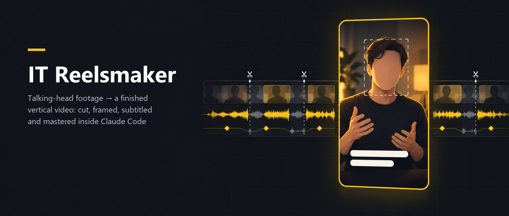
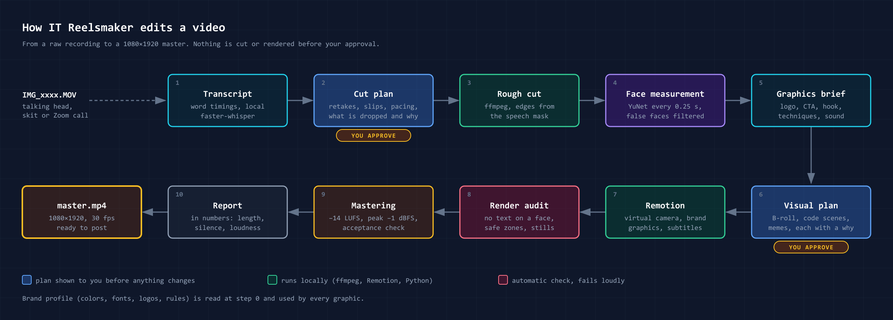
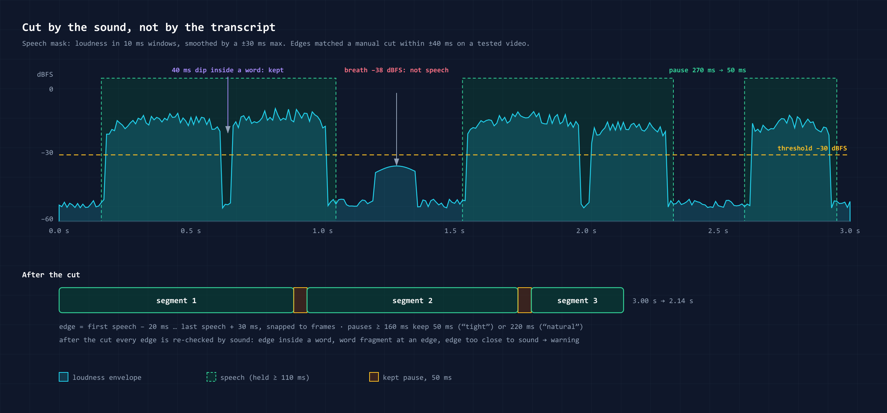
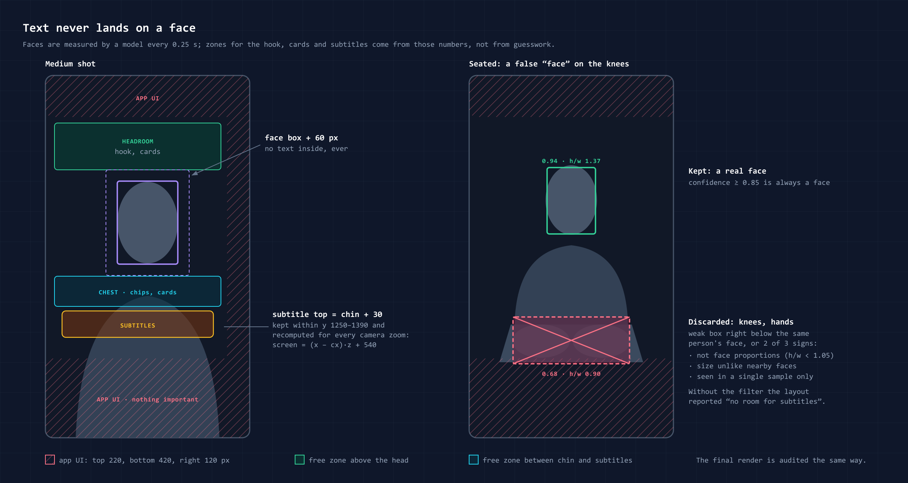

# IT Reelsmaker — плагин Claude Code для монтажа вертикальных роликов

🎬 Даёте Claude сырой дубль, на котором вы говорите в камеру, и получаете готовый ролик 1080×1920 для Reels, Shorts или TikTok. Паузы и оговорки вырезаны, есть субтитры по словам, графика в цветах вашего бренда, и громкость доведена до нормы площадок. Всё монтируется на вашем компьютере, и ничего не режется, пока вы не сказали «да». [English README](README.md).

Можно и без съёмки: надиктуйте текст на телефон, и получится ролик из нарисованных сцен с вашим голосом. Его может вести маскот бренда, у которого рот двигается под вашу запись.

Плагин не привязан к одной компании. Бренды хранятся отдельными профилями (цвета, шрифты, логотипы, тон), их может быть сколько угодно, и перед монтажом агент спрашивает, для какого бренда ролик. Все цифры в правилах взяты из монтажа настоящих роликов.

## 🎁 Что вы получаете

Из одной записи, например 1–2 минут на телефон:

- **готовый ролик** 1080×1920: нарезан, с «камерой», субтитрами и графикой бренда, громкость −14 LUFS (норма соцсетей);
- **обложку**: выбрана из кадров ролика, вшита в файл и лежит рядом картинкой;
- **субтитры файлом `.srt`**, по просьбе и в переводе на другой язык;
- **отчёт цифрами**, а не «стало лучше»: длина, сколько тишины осталось, громкость, сколько вырезано дублей и почему какие-то вставки не встали.

Подкаст, вебинар или интервью на 10–90 минут превращается в **серию коротких клипов**. Список клипов вы утверждаете один раз, дальше каждый собирается как отдельный ролик.

## 🆕 Без камеры: голос, сцены и маскот

**Сцены поверх вашего голоса.** Не хочется сниматься? Запишите голосовое на телефон (m4a, wav, mp3, ogg, opus). Плагин режет его так же, как видео: убирает паузы, неудачные дубли и выравнивает громкость. Поверх голоса агент рисует кодом сцены: заголовки, цифры, списки, «было → стало». Получается ролик-объяснялка с вашим голосом и субтитрами, без лица в кадре. Субтитры остаются видны и поверх сцен, а текст сцены не наезжает на них. Если под голосом играет музыка или шумит комната, плагин сразу предупредит: музыку лучше добавить потом, при сведении.

**Маскот бренда.** Персонаж в цветах бренда стоит рядом со сценами: моргает, «дышит», а на словах, которые вы выберете, показывает на сцену, раскрывает ладонь, задумывается или радуется. Рот открывается в такт вашей записи: громче речь — шире рот, в паузах он закрыт. Это не синтез речи и не нейросеть, персонаж нарисован кодом, а голос ваш. Тон бренда решает, насколько маскот живой: у премиального бренда его нет, у спокойного он сдержан, у дерзкого может подпрыгнуть на смене позы. Плагин следит, чтобы маскот не закрывал субтитры, кнопки приложения и другую графику. Если вы перемонтировали голос, а рот остался от старой версии, плагин откажется собирать ролик.

**Маскот из вашей картинки.** Есть готовый персонаж от иллюстратора? Дайте лист его поз (одной картинкой-сеткой или папкой PNG), и плагин сам вырежет фон и выровняет позы так, чтобы голова не прыгала. Глаза, рот и моргание он оживит поверх картинки. Если нарисуете кадры «говорит» и «моргнул», выйдет ещё естественнее. Картинку с несимметричной деталью (логотип на футболке, пробор) плагин никогда не отразит зеркально.

## ⚙️ Как это работает



1. **Бренд и стиль.** Берётся сохранённый бренд, или новый заводится из названия, 1–3 цветов и тона. Тонов восемь, от премиального и тёплого до продающего и дерзкого. Тон сразу решает, можно ли мемы, сколько вставок и насколько громкие приёмы. Стилей подачи шесть: плашка-маркер, фирменный, минимализм, журнальный, дерзко, стекло.
2. **Расшифровка по словам** прямо на вашем компьютере и поиск дублей и оговорок.
3. **План нарезки → ваше «да».** Что остаётся, что вырезается и почему. Плюс 2–3 варианта начала и концовки: по порядку, без медленного разгона или с сильной фразой из середины в самом начале.
4. **Черновой монтаж по звуку.** Края склеек находятся по самой речи: на проверенном ролике они совпали с ручной нарезкой до 40 мс. Громкость выравнивается между кусками, цвет подстраивается по замеру, а не на глаз.
5. **Визуальный план → ваше «да».** Таблица: на каком слове какая сцена, вставка или мем и зачем они там. Вы видите её до рендера.
6. **Рендер в Remotion** с виртуальной камерой. Потом проверка, что никакой текст не лёг на лицо. Готовый ролик агент сначала просматривает сам и исправляет, что нашёл, и только потом показывает вам.
7. **Сведение звука и сдача с цифрами.**

**Три режима работы.**
- `quick` для знакомого бренда ничего не спрашивает заранее и останавливается дважды: на плане нарезки и на превью.
- `standard` (по умолчанию) добавляет первый вопрос и раскадровку.
- `full` ещё спрашивает, что это за ролик (обучающий, развлекательный, реклама…), и объясняет каждое решение.

Ответы одного ролика можно сохранить как **пресет серии**, и следующие ролики пойдут с теми же настройками.

## 🧠 Что внутри (простыми словами)

- **Режет по звуку, а не по таймеру.** Вдох не считается словом, тихое окончание фразы не обрезается, паузы сжимаются до естественных.
- **Находит дубли.** Когда вы начали фразу заново или сказали «так, ещё раз», агент это замечает и берёт удачный вариант. Если сказали «вот это хорошо», он берёт предыдущий дубль.
- **Камера из одного дубля.** Общий, средний, крупный план, наезд и отъезд, хотя снимали вы одним кадром. Насколько можно приблизить без потери качества, считается заранее.
- **Графика привязана к словам, а не к секундам.** Перемонтировали — всё само встало на новые места.
- **Лица под защитой.** Плагин находит лицо на каждом кадре и не даёт субтитрам, плашкам и мемам на него наехать. Ложные «лица» (колени, складки одежды) он отбрасывает.
- **Сцены кодом.** Заголовок, цитата дословно, цифра со счётчиком и источником, список, «было → стало», призыв к действию, обложка. Агент рисует их сам в цветах бренда, без нейросетей и стоков. Есть промо бренда совсем без съёмки на 15–25 секунд.
- **Звук.** Короткие звуки (щелчок, «вжух», удар) собираются кодом, без библиотек и лицензий. Звук ставится только туда, где на экране что-то происходит, и попадает точно в момент. Музыка стоит на 15 дБ тише голоса, приглушается под речь и начинается с самой насыщенной части трека, а не с тихого вступления.
- **Честная самопроверка.** Если чего-то не хватает (программы, шрифта, модели) или шаг не удался, агент прямо скажет, что изменится в ролике, а не подменит молча. Он ищет и места, где картинка слишком долго не меняется, и признаки «слайд-шоу».
- **Быстрые правки.** Поменяли слово в субтитре — перерисовывается только этот кусок, около минуты вместо 8–10 на весь ролик.
- **Сведение.** −14 LUFS, без перегрузки, видео при этом не перекодируется. Не прошло проверку — ролик не отдаётся.
- **Мемы по правилам.** Только с понятной лицензией, небольшие, у края кадра и не на лице.





## ✨ Приёмы на выбор

Сами в ролик не попадают, только если вы их выбрали:

- формат «в рамке» для Zoom-интервью и вебинаров;
- засвет вместо обычного перехода;
- ключевая фраза на весь экран;
- сцены: хук, цитата, слоган, цифра, список, призыв к действию, подпись к посту;
- обложка прямо в готовом файле;
- сценка вдвоём со шкалой «вердикта»;
- 12 готовых призывов к действию;
- B-roll, сцены кодом и мемы — через визуальный план, с ограничением, сколько их можно.

**Пока экспериментальные.** Агент предлагает их, только когда материал явно просит, и честно пишет в плане «experimental». По прямой просьбе делает как обычно:

- текст за человеком (фигура вырезается из кадра), в том числе слово, которое зачёркивается и меняется на другое;
- ведущий поверх записи экрана или сцены, как в обзорах и стримах;
- телефон с экраном на призыве к действию;
- сцены «переписка» и «интерфейс с курсором»;
- **выноски на предметах**, как в обзорах квартир и техники: точка на вещи в кадре, линия и подпись («диван», «вид с балкона»). Ещё бывают цена в кружке, кольцо вокруг одного предмета и размерная линия. Если камера движется, выноска едет за предметом.

## 🎛 Что настроить под себя

**Бренды** лежат в папке вашего проекта, `brands/<slug>/`. Проще всего сказать агенту: «новый бренд — название, цвета, логотип». В профиле хранятся:
- название, тон бренда, фирменная фраза;
- цвета (хватит 1–3, остальное агент подберёт сам);
- шрифты с пометкой, у каких есть кириллица;
- логотипы, LUT и маскот;
- запретные образы и слова;
- контакты для призывов к действию;
- кто одобряет публикацию и тип аккаунта (от него зависит, какую музыку можно).

Обновление плагина профили не трогает.

**Профиль ролика** (обучающий, развлекательный, ролик эксперта, промо, реклама) подстраивает настройки под задачу и проверяет черновик по своему чек-листу. В рекламе, например, весь текст держится в безопасной зоне.

**Свои правила монтажа** можно записать в `playbook.md` проекта. План и отчёт показывают, какое правило стоит за каждым решением. Не понравилось — правите правило, а не весь ролик.

**Своя библиотека звуков, музыки и иконок** подключается по желанию. Своих звуков нет — есть стартовый набор из 260 бесплатных звуков CC0 в [релизах](https://github.com/itpartypattaya/reels-montage/releases/tag/sfx-cc0-1).

## 📦 Установка

```bash
claude plugin marketplace add https://github.com/itpartypattaya/reels-montage.git
```

```bash
claude plugin install it-reelsmaker@itparty
```

Потом в Claude Code, в папке для монтажа, просто напишите, например: «Смонтируй рилс из IMG_4821.MOV для Acme, плотный темп, стиль маркер, с субтитрами». Или: «Вот моё голосовое, сделай из него ролик со сценами».

**Что должно стоять на компьютере:**
- [Claude Code](https://claude.com/claude-code);
- `ffmpeg`;
- Node.js 18+. Проект [Remotion](https://www.remotion.dev/) плагин создаст сам. У Remotion своя лицензия: бесплатно для частных лиц, некоммерческих организаций и компаний до 3 сотрудников, компании побольше (например, агентству) нужна платная ([условия](https://github.com/remotion-dev/remotion/blob/main/LICENSE.md));
- Python 3.9+ и [Pillow](https://pypi.org/project/pillow/) (`pip install Pillow`);
- для расшифровки — `faster-whisper`, работает на вашем компьютере.

**По желанию:** `rembg` для вырезки фигуры, модель YuNet и OpenCV для замера лиц ([`references/faces.md`](skills/it-reelsmaker/references/faces.md)), отдельное дополнение [`it-reelsmaker-online`](../it-reelsmaker-online/README.md) с онлайн-источниками. Без них плагин тоже работает: вставки рисуются сценами, лица проверяются по кадрам.

Без системы плагинов можно скопировать папку `skills/it-reelsmaker/` в `~/.claude/skills/it-reelsmaker/`.

**Переезд с `reels-montage`** (до версии 1.0 скилл ставился клонированием в `~/.claude/skills/reels-montage`): поставьте плагин, перенесите профили брендов в `<проект>/brands/<slug>/` (скилл предложит сделать это сам) и удалите старую копию.

## 🔄 Обновления

- **Из каталога Claude** (Customize → Plugins) плагин обновляется сам. Новая версия загрузится в следующей сессии.
- **Из маркетплейса этого репозитория** автообновление по умолчанию выключено. Включить один раз: `/plugin` → **Marketplaces** → `itparty` → **Enable auto-update**. Обновить вручную — две команды в терминале, потом `/reload-plugins` или новая сессия:

```bash
claude plugin marketplace update itparty
```

```bash
claude plugin update it-reelsmaker@itparty
```

Версия в каталоге может отставать, а из маркетплейса всегда ставится самая свежая. Что изменилось в каждой версии — в [CHANGELOG.md](CHANGELOG.md) (на английском). После обновления скилл один раз покажет короткий блок «Что нового».

## 🔒 Ваши данные

Плагин ничего не собирает: у него нет своего сервера и телеметрии. Видео, расшифровки и профили брендов остаются в папке проекта. С компьютера уходит только:
- ваш разговор с Claude, как в любой сессии Claude Code (с текстом расшифровок и кадрами, которые смотрит агент);
- звук в облачный распознаватель, если вы сами его выбрали;
- обычные загрузки при установке пакетов, шрифтов и моделей для включённых функций.

Модель лиц только находит, где лицо, а людей не узнаёт. Подробно — [PRIVACY.md](PRIVACY.md).

## Поддержка

Вопросы и ошибки — [GitHub Issues](https://github.com/itpartypattaya/reels-montage/issues) или mr.a.vaskov@gmail.com.

## Лицензия

[MIT](LICENSE): можно свободно использовать, менять и распространять с сохранением уведомления об авторских правах.
